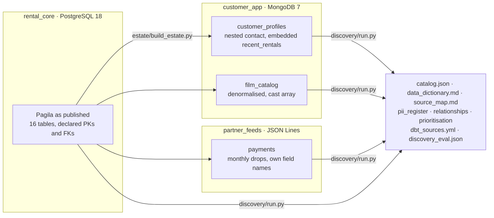

# Data Discovery & Governance Across PostgreSQL, MongoDB and JSON

[](https://github.com/Saigwe/data-discovery-governance/actions/workflows/ci.yml)

> A discovery tool that profiles every table, collection and feed in a three-system estate. It infers primary and foreign keys, including links between systems that declare none; classifies personal data; catches schema drift and numbers sent as text; and scores each dataset's data confidence. It writes the data dictionary, the source map, a PII register and dbt sources with tests generated from what it found. Then it is graded against what is known to be true: Postgres's own declared keys and a set of planted problems.

**Author:** Stanley Igwe, Lead Data (Analytics) Engineer · [Portfolio](https://saigwe.github.io)
**Stack:** Python · PostgreSQL 18 · MongoDB 7 · JSON Lines · dbt (generated sources) · GitHub Actions
**Status:** ✅ CI starts PostgreSQL and MongoDB, loads Pagila, builds the estate, runs discovery and publishes the catalogue to the [`catalog` branch](https://github.com/Saigwe/data-discovery-governance/tree/catalog). pytest 9/9.

For VoCoVo I profiled 56 tables across PostgreSQL, MongoDB and JSON, prioritised 36 of them for governed reporting, and built the data dictionary, source map and a model with explicit data-confidence measures. This project rebuilds that method on public data and adds what the client work had no time for: a measurement of how accurate the discovery is. No client data is used.

---

## 90-second summary
| | |
|---|---|
| **Problem** | A new data team inherits databases nobody documented: a relational system of record, an app team's document store and a partner's file drops, with different field names for the same thing and no foreign keys between them. Before anything is reported on, someone has to find out what is there, how it joins, what is personal data and what can be trusted. |
| **What I built** | Connectors that hand every source over as plain records (nested documents flattened into paths); a profiler (types, completeness, uniqueness, value patterns); key and inclusion-dependency discovery; PII classification; drift detection; a data-confidence score; and generators for the catalogue, dictionary, source map, PII register, prioritisation and dbt sources. |
| **Why it matters** | It turns weeks of manual profiling into a repeatable run with a measured error rate, and hands governance a starting point it can check: generated `unique`, `not_null` and `relationships` tests. |
| **Proof** | Against Postgres's declared keys: primary keys 13/13; foreign keys found with precision 0.955 and recall 0.955 (21 of 22). Across systems with no declared keys: 8 of 8 planted links found. Planted drift 1/1, amounts-as-text caught, 21 PII fields with no false positives. See [Results](#results). |

## The estate


- **rental_core**: [Pagila](https://github.com/devrimgunduz/pagila) (PostgreSQL licence), the standard sample DVD-rental database, pinned to a commit and loaded exactly as published. It is the system of record and, because it declares its keys, it is also the answer key for key discovery.
- **customer_app**: what an app team builds from it. Customer profiles with nested names and contact details and an embedded list of recent rentals, and a denormalised film catalogue with a cast array.
- **partner_feeds**: a payment provider's monthly JSON-lines drops, with its own field names (`transactionId`, `customerRef`, `rentalRef`) and amounts sent as text.

`estate/build_estate.py` plants known problems with a fixed seed and writes them to `estate/planted.json`. The profiler never reads that file; only the evaluation does:

| Planted | Where |
|---|---|
| 5% of profiles spell the e-mail field `emailAddress` (schema drift) | customer_profiles |
| 3% of profiles have no phone | customer_profiles |
| Amounts sent as text | partner payments |
| 8 cross-system links: profile → customer, embedded rental → rental and film, profile → store, catalogue → film and actor, payment → customer and rental | MongoDB and JSON → Postgres |

## How discovery works
- **Profiling** (`discovery/profile.py`): every field gets its types seen, completeness, distinct count, uniqueness, top value pattern (`Aa+ Aa+`, `9+-9+`), min/max and a PII class. Nested documents become paths (`contact.address.city`); arrays of documents become `recent_rentals[].film_id`, so MongoDB, JSON and SQL are profiled by the same code.
- **Primary keys**: unique, complete fields of a key-like type.
- **Foreign keys**: a field whose distinct values sit at least 99% inside another dataset's key, with a related name (`customerRef` normalises to `customer`). The parent must be the dataset's own key ("customer.customer_id", not a unique "customer.address_id"). Where a key name has several homes, the dataset named exactly for it wins, so `film_id` points at `film`, not at its 1:1 extensions `film_embedding` or `film_catalog`. Containment alone over-matches small integer ranges; the name rules are what make it precise.
- **PII**: judged on the field's last two path segments, so `name.first` and `cast[].name` are person names but a category's `name` is not. Value patterns (e-mail, phone, card number) apply only to text, so a date is never taken for a phone number.
- **Drift**: two spellings of one field in one dataset whose completeness adds up to about 100%.
- **Data confidence**: a 0–100 score from parts that can be explained line by line: 30% completeness, 20% type consistency, 20% conformance (numbers or timestamps sent as text and drifting fields count against it), 20% having a primary key, 10% freshness. A dataset is **ready for governed reporting** at 75 or above with a key.

## Results
From CI on the pinned Pagila commit, as of 26 Oct 2026 ([`discovery_eval.json`](https://github.com/Saigwe/data-discovery-governance/blob/catalog/results/discovery_eval.json)).

| Measure | Result |
|---|---|
| Datasets / fields profiled | 19 (16 PostgreSQL, 2 MongoDB, 1 JSON feed) / 129 |
| Primary keys (declared single-column) | 13 of 13 |
| Foreign keys within PostgreSQL | 22 declared, 22 discovered, 21 correct: **precision 0.955, recall 0.955** |
| Cross-system links (none declared anywhere) | **8 of 8 planted**, 1 extra |
| Schema drift | 1 of 1 planted, 0 false |
| Amounts sent as text | detected |
| PII fields | 21: 9 person names, 4 e-mail, 3 street address, 2 postal code, 2 phone, 1 credential; none false |
| Ready for governed reporting | 17 of 19 |

**What it got wrong, and why**
- **Missed `film.original_language_id → language`.** The column is empty in Pagila, so there are no values to contain. A declared key with no data behind it can't be discovered from data.
- **"Extra" `store.manager_staff_id → staff`.** The link is real: every store manager is a member of staff. Pagila just doesn't declare it, so it counts against precision. Discovery found an undocumented relationship, which is part of the point.
- **Extra cross-system link `profile.contact.address.country → country.country`.** It is a genuine natural-key lookup: the app stores country names, not ids.
- **Composite keys aren't discovered.** `film_actor` and `film_category` are keyed on two columns, so they score without a key and are not ready for reporting.

**How it got there.** The first CI run had foreign-key precision 0.50 and recall 0.79. Fixes, each with a unit test:
- reverse links (a key pointing at a foreign key);
- 1:1 extension tables taken as parents;
- partition-declared keys not mapped to their parent table;
- "address" singularised to "addres".

PII had three false positives (a category's and a language's `name`, a date taken for a phone number), and the nested `name.first` and `name.last` were missed. The early numbers are in the commit history.

**Data confidence and prioritisation** ([`prioritisation.csv`](https://github.com/Saigwe/data-discovery-governance/blob/catalog/results/prioritisation.csv))

17 of 19 datasets are ready for governed reporting. The ones that score lowest are where the problems are:

| Dataset | System | Completeness | Type consistency | Conformance | Primary key | Freshness | Score | Ready |
|---|---|---:|---:|---:|---:|---:|---:|---|
| rental_core.customer (best of 10 tied) | PostgreSQL | 1.00 | 1.00 | 1.00 | yes | 0.76 | 97.6 | yes |
| rental_core.staff | PostgreSQL | 0.91 | 1.00 | 1.00 | yes | 0.76 | 94.8 | yes |
| partner_feeds.payments | JSON | 1.00 | 1.00 | **0.67** (amount and paidAt sent as text) | yes | 1.00 | 93.3 | yes |
| rental_core.address | PostgreSQL | 1.00 | **0.75** (postal_code and phone mix digit-only values with other text) | 1.00 | yes | 0.76 | 92.6 | yes |
| customer_app.customer_profiles | MongoDB | 0.89 | 1.00 | **0.79** (email / emailAddress drift, created_at as text) | yes | 1.00 | 92.6 | yes |
| rental_core.film_actor | PostgreSQL | 1.00 | 1.00 | 1.00 | **no** (two-column key) | 0.76 | 77.6 | no |
| rental_core.film_category | PostgreSQL | 1.00 | 1.00 | 1.00 | **no** (two-column key) | 0.76 | 77.6 | no |

Freshness is 1 minus the age of a dataset's latest timestamp over a year: the Postgres tables' newest rows are about three months old at the run date (0.73–0.76), the generated estate is dated on the day.

## Outputs (published to the `catalog` branch on every push)
| File | For |
|---|---|
| [`catalog/data_dictionary.md`](https://github.com/Saigwe/data-discovery-governance/blob/catalog/catalog/data_dictionary.md) | People: one section per dataset, every field's type, completeness, uniqueness, pattern and PII class |
| [`catalog/source_map.md`](https://github.com/Saigwe/data-discovery-governance/blob/catalog/catalog/source_map.md) | A Mermaid map of the three systems and the links found between them |
| `catalog/catalog.json` | Machines: the full profile |
| `results/pii_register.csv` | The privacy team: every personal-data field, by system |
| `results/relationships.csv` | Every discovered key link with its containment |
| `results/prioritisation.csv` | Confidence score parts and readiness per dataset |
| `results/dbt_sources.yml` | The hand-off to governance: dbt sources with `unique`, `not_null` and `relationships` tests generated from the discovered keys |

## Tests
pytest, no database needed: path flattening of nested documents and arrays; type and pattern inference; PII by name, by value and by path context; inclusion dependencies (containment plus a related name, own-key parents, exact homes beating extensions, two-value keys allowed by name); drift detection; the conformance part of the confidence score; and the MongoDB connector against `mongomock`. CI then runs discovery end to end on real PostgreSQL and MongoDB and grades it.

## Run it
```bash
pip install -r requirements.txt
make all   # needs PostgreSQL 18 with pgvector (Pagila uses uuidv7 and vectors) and MongoDB; CI starts both as services
```

## Data licence
Pagila is released under the PostgreSQL licence (Devrim Gündüz and contributors); it is downloaded at a pinned commit, not redistributed. The MongoDB and JSON estate is generated from it by `estate/build_estate.py`.
